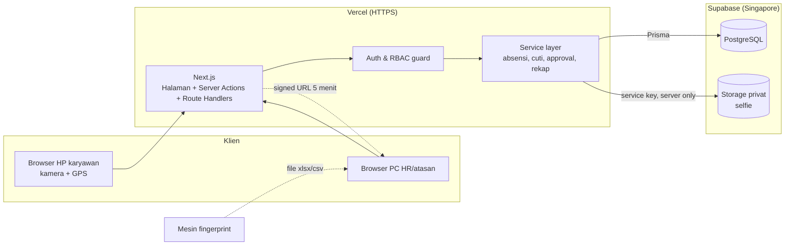

# Architecture — HRIS (Phase 4)

Status: READY FOR REVIEW (2026-10-22). Dasar: requirement, scope, dan UI/UX yang sudah APPROVED.

Prinsip: **satu aplikasi (monolit) Next.js**, dependency seminimal mungkin, semua aturan bisnis dan otorisasi di server. Skala 100 karyawan / 3 cabang tidak butuh microservice, queue, atau cache terpisah.

## 1. Technology stack
| Lapisan | Pilihan | Alasan |
|---------|---------|--------|
| Framework | **Next.js (App Router) + TypeScript** | Frontend + backend dalam satu proyek; satu deploy. |
| Styling | **Tailwind CSS** | Cepat dan konsisten dengan design system Phase 3. |
| Komponen UI | **shadcn/ui** (Radix) | Komponen disalin ke proyek (bukan dependency besar), aksesibel. |
| Database | **PostgreSQL** | Relasional, transaksi kuat untuk saldo cuti & approval. |
| ORM & migrasi | **Prisma** | Skema terketik + migration file yang bisa direview. |
| Validasi | **Zod** | Satu skema validasi dipakai di form dan server. |
| Autentikasi | **Session di database + cookie httpOnly**; password di-hash dengan **scrypt (bawaan Node.js)** | Tanpa library auth tambahan; kontrol penuh atas RBAC, nonaktifkan akun, dan audit. |
| Penyimpanan foto | **Supabase Storage, bucket privat** + signed URL berumur pendek | Gratis 1 GB, satu penyedia dengan database. |
| Kompresi selfie | Canvas di browser → JPEG ±640 px, kualitas 0,7 (≈60–100 KB) | Tanpa library; hemat storage gratis. |
| Baca file fingerprint | **exceljs** (xlsx) + parser CSV sederhana | Satu dependency untuk format Excel. |
| Ekspor rekap | **exceljs** (xlsx) + CSV | Sama dengan impor. |
| Peta (pengaturan lokasi) | **Leaflet + OpenStreetMap** | Gratis, tanpa API key. |
| Testing | **Vitest** (unit/integrasi), **Playwright** (E2E alur kritis) | |
| Version control | **Git + GitHub (repo privat)** | Wajib untuk deploy otomatis. |

## 2. Hosting testing (free tier)
| Komponen | Layanan | Batas gratis yang relevan |
|----------|---------|----------------|
| Aplikasi | **Vercel Hobby** | HTTPS otomatis (wajib untuk kamera/GPS di HP); hanya untuk penggunaan non-komersial. |
| Database + Storage | **Supabase Free** | DB 500 MB, storage 1 GB; proyek di-pause setelah 7 hari tidak dipakai; tanpa backup otomatis yang bisa diunduh. |

- **Region:** Supabase Singapore (`ap-southeast-1`) dan Vercel function region `sin1`, dekat dengan pengguna di Indonesia.
- **Development lokal:** memakai database Supabase proyek "dev" yang terpisah, jadi **tidak perlu memasang PostgreSQL/Docker** di laptop. Kamera bisa dites di `localhost` dari laptop; tes di HP lewat URL preview Vercel (HTTPS).
- **Production (Phase 17):** pindah ke paket berbayar atau VPS di Indonesia. Keputusan diambil terpisah.

## 3. Architecture diagram

Browser **tidak pernah** mengakses database atau storage secara langsung; semua lewat server Next.js.

## 4. Folder structure
```
hris/
├─ prisma/
│  ├─ schema.prisma
│  ├─ migrations/
│  └─ seed.ts                  # data awal: role, permission, admin pertama
├─ src/
│  ├─ app/
│  │  ├─ (auth)/login/
│  │  ├─ (app)/                # semua halaman setelah login (layout + nav per role)
│  │  │  ├─ beranda/  absen/  riwayat/  pengajuan/  approval/
│  │  │  ├─ kehadiran/  karyawan/  jadwal/  impor-fingerprint/
│  │  │  ├─ laporan/  pengaturan/  admin/
│  │  └─ api/
│  │     ├─ attendance/route.ts      # clock-in/out (multipart: foto + koordinat)
│  │     ├─ fingerprint/route.ts     # unggah file impor
│  │     └─ export/route.ts          # unduh xlsx/csv
│  ├─ server/                  # hanya berjalan di server
│  │  ├─ auth.ts               # session, hash password, requireUser/requirePermission
│  │  ├─ db.ts                 # Prisma client
│  │  ├─ storage.ts            # upload & signed URL foto
│  │  ├─ audit.ts              # tulis audit log
│  │  └─ services/             # attendance.ts, leave.ts, approval.ts, recap.ts, fingerprint.ts
│  ├─ lib/                     # fungsi murni: geo.ts (haversine), time.ts (WIB, shift malam), validators.ts
│  └─ components/              # ui/ (shadcn) + komponen khusus (CameraCapture, LocationStatus, ...)
├─ tests/                      # unit + e2e
├─ docs/
└─ .env.example                # daftar variabel, tanpa nilai rahasia
```

## 5. Data flow — clock-in
```mermaid
sequenceDiagram
  participant HP as Browser HP
  participant S as Server Next.js
  participant DB as PostgreSQL
  participant ST as Storage privat
  HP->>HP: getUserMedia (kamera) + geolocation (lat, long, akurasi)
  HP->>HP: kompres foto ke JPEG ±80 KB, buat idempotency key
  HP->>S: POST /api/attendance (foto, lat, long, akurasi, key)
  S->>S: cek session, role, karyawan aktif, metode absen
  S->>S: validasi input (Zod), tipe & ukuran file (≤ 1 MB, JPEG)
  S->>DB: cek idempotency key & sudah clock-in di jadwal ini?
  S->>S: waktu = jam server; hitung jarak (haversine) ke lokasi kerja terdekat; tentukan label
  S->>ST: simpan foto (path acak, privat)
  S->>DB: transaksi: simpan absensi + metadata + audit log
  S-->>HP: hasil: jam WIB, lokasi, jarak, label
```
Catatan:
- **Waktu dari HP diabaikan.** Yang dipakai hanya jam server.
- **Koordinat dari HP tidak bisa diverifikasi penuh** (bisa dipalsukan aplikasi fake GPS). Server menyimpan metadata (akurasi, user agent, IP) untuk membantu pemeriksaan, sesuai batasan di REQUIREMENTS §8.
- Penyimpanan waktu: `timestamptz` (UTC) di database; tampilan selalu `Asia/Jakarta`.

## 6. API strategy
- **Server Actions** untuk form biasa (CRUD karyawan, pengajuan cuti, approval, pengaturan).
- **Route Handlers** (`/api/*`) hanya untuk: unggah foto absensi, unggah file fingerprint, dan unduh ekspor.
- Tidak ada API publik untuk pihak luar di MVP.
- Setiap action/handler dimulai dengan `requirePermission('modul.aksi')` dan pembatasan data (scope): **diri sendiri / tim / cabang / semua**.
- Format error seragam: `{ ok: false, message: "pesan untuk pengguna" }`; detail teknis hanya di log server.

## 7. Authentication & authorization
- **Login:** NIK/email + password. Password di-hash dengan scrypt + salt per pengguna.
- **Session:** token acak 32 byte di cookie `httpOnly`, `Secure`, `SameSite=Lax`. Di database hanya disimpan hash token-nya. Masa berlaku 12 jam sejak aktivitas terakhir (sliding). Logout dan nonaktifkan akun langsung menghapus session.
- **Rate limit:** login maksimal 5 gagal per 15 menit per akun + IP. Dicatat di tabel database karena serverless tidak punya memori bersama.
- **RBAC:** tabel `roles`, `permissions`, `role_permissions`; pengguna bisa punya lebih dari satu role. Role bawaan dari seed:
  - Super Admin
  - HR Manager
  - HR Admin
  - Dept Manager
  - Supervisor
  - Employee
- **Pembatasan data (row-level):**
  - Supervisor: bawahan langsung.
  - Dept Manager: departemennya.
  - HR: semua data.
  - Employee: hanya data sendiri.
  - Ditegakkan di service layer, bukan hanya dengan menyembunyikan menu.

## 8. Security strategy
| Ancaman | Penanganan |
|---------|-----------|
| SQL injection | Query hanya lewat Prisma (parameterized); tidak ada raw SQL dari input. |
| XSS | React escape otomatis; tidak memakai `dangerouslySetInnerHTML`; header CSP. |
| CSRF | Server Actions memeriksa Origin; cookie `SameSite=Lax`; route POST memeriksa Origin. |
| Akses foto tanpa izin | Bucket privat; foto hanya lewat signed URL 5 menit setelah cek permission. |
| Upload berbahaya | Batasi tipe (JPEG / xlsx / csv) dan ukuran; nama file acak; tidak pernah dieksekusi. |
| Brute force login | Rate limit + pesan error generik. |
| Kebocoran secret | Semua kunci di environment variable (Vercel/`.env.local`); `.env*` di `.gitignore`. |
| Manipulasi data absensi | Jam server, idempotency key, unique constraint per karyawan per jadwal, koreksi hanya lewat approval, audit log. |
| Audit log diubah | Aplikasi hanya punya fungsi tambah (append-only); tidak ada UI/aksi ubah atau hapus. |
| Header | HSTS, X-Content-Type-Options, Referrer-Policy, Permissions-Policy (kamera & lokasi hanya untuk situs sendiri). |
| Privasi (UU PDP) | Lokasi hanya diambil saat absen; pemberitahuan pemrosesan data saat login pertama; kebijakan retensi foto dirancang di Phase 5. |

## 9. Logging & error handling
- **Audit log (database):** siapa, aksi, objek, sebelum/sesudah, alasan, waktu, IP.
- **Log teknis:** `console` terstruktur (JSON) yang terbaca di log Vercel; tanpa password, token, atau foto.
- **Error di UI:** `error.tsx` per halaman berisi pesan awam + tombol coba lagi (sesuai UI_UX_PLAN §7).

## 10. Integrasi fingerprint
- **MVP:** HR mengunggah file ekspor mesin (xlsx/csv) di halaman Impor.
- **Pemetaan kolom:** dapat dikonfigurasi (kolom ID, tanggal, jam), sehingga tidak terikat satu merek.
- **Data mentah:** setiap scan disimpan, dengan unique constraint `(id_mesin, waktu)` agar impor ulang tidak membuat duplikat.
- **Setelah MVP:** sinkron otomatis via agen kecil di PC kantor atau API mesin, tergantung merek (Q9).

## 11. Backup & environment
- **Environment:**
  - `development` di laptop, memakai Supabase "dev".
  - `preview` di Vercel untuk tes di HP, memakai Supabase "dev".
  - `production` di Phase 17.
- **Variabel:** `DATABASE_URL`, `DIRECT_URL`, `SUPABASE_URL`, `SUPABASE_SERVICE_ROLE_KEY`, `SESSION_SECRET`, `APP_TIMEZONE=Asia/Jakarta`. Contohnya ada di `.env.example`, tanpa nilai.
- **Backup selama testing:** `pg_dump` manual mingguan oleh admin, karena free tier tidak menyediakan backup yang bisa diunduh. Backup otomatis harian wajib ada sebelum production.
- **Migrasi:** `prisma migrate dev` di lokal. `prisma migrate deploy` saat deploy; migrasi yang destruktif wajib approval.

## 12. Deployment strategy (testing)
1. Repo privat GitHub → terhubung ke Vercel.
2. Setiap push ke branch selain `main` → preview URL (HTTPS) untuk tes di HP.
3. Push/merge ke `main` → deploy environment testing utama.
4. Migrasi database dijalankan saat build (`prisma migrate deploy`).
5. Tidak ada deploy production sebelum Phase 17 disetujui.

## 13. Technical risks
| Risiko | Dampak | Mitigasi |
|--------|--------|----------|
| Vercel Hobby melarang penggunaan komersial | Tidak boleh dipakai untuk operasional sungguhan | Hanya untuk testing; production pindah ke paket berbayar/VPS (Phase 17). |
| Supabase free di-pause setelah 7 hari tidak aktif | Aplikasi testing mati sementara | Aktifkan kembali dari dashboard; dipakai rutin selama UAT. |
| Storage 1 GB penuh | Foto baru gagal tersimpan | Kompresi ±80 KB/foto (±16 MB/hari untuk 100 orang → cukup ±2 bulan); monitor pemakaian. |
| GPS palsu / foto dari layar lain | Kecurangan absensi | Label lokasi + metadata + pemeriksaan HR; tidak diklaim bisa dicegah penuh. |
| Safari iPhone membatasi kamera/GPS | Gagal absen di iPhone | Uji di iPhone sejak Phase 9; panduan izin khusus Safari. |
| Format file fingerprint belum diketahui | Impor gagal | Pemetaan kolom yang bisa diatur; contoh file dari mesin (Q9) sebelum Phase pembuatan modul impor. |
| Data pribadi di layanan luar negeri (Singapore) | Kepatuhan UU PDP | Dicatat sebagai keputusan bisnis; dievaluasi ulang sebelum production. |
| Belum ada Git di laptop | Tidak bisa versioning/deploy | Pasang Git sebelum Phase 7. |

## 14. Prasyarat sebelum Phase 7 (tindakan user)
1. Pasang **Git for Windows**.
2. Buat akun **GitHub**, **Vercel**, dan **Supabase** (gratis). Login dan pembuatan akun dilakukan sendiri oleh user; kunci API dimasukkan sendiri ke `.env.local` / dashboard Vercel.
3. Pilih folder permanen untuk proyek.
