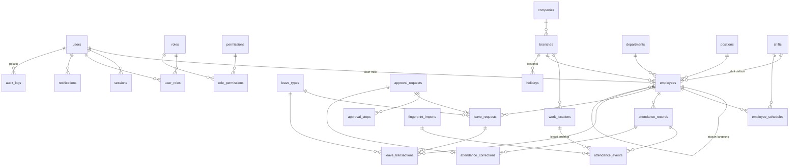

# Database Design — HRIS (Phase 5)

Status: READY FOR REVIEW (2026-10-22). PostgreSQL + Prisma (`docs/ARCHITECTURE.md`). Hanya tabel untuk **MVP** (28 tabel). Lembur, kontrak, dokumen, dan payroll belum dibuat.

Konvensi:
- PK `id` UUID (`gen_random_uuid()`), kecuali `audit_logs` (bigint identity) dan tabel penghubung (PK gabungan).
- Waktu disimpan sebagai `timestamptz` (UTC) dan ditampilkan di `Asia/Jakarta`. Tanggal kerja memakai `date`.
- Setiap tabel master punya `created_at` dan `updated_at`.
- **Tidak ada hard delete** untuk data master/transaksi. Yang ada: nonaktifkan (`is_active`) atau ubah status.
- Nama tabel/kolom memakai bahasa Inggris (snake_case), sedangkan label di UI berbahasa Indonesia.

## 1. ERD

Tabel `login_attempts` dan `system_settings` berdiri sendiri (tanpa relasi).

## 2. Data dictionary

### A. Auth & RBAC
**users**
| Kolom | Tipe | Keterangan |
|---|---|---|
| id | uuid PK | |
| email | text unique null | Login alternatif. |
| login_id | text unique | Biasanya = `employees.employee_code`. |
| password_hash | text | scrypt + salt (format `scrypt$N$r$p$salt$hash`). |
| is_active | bool default true | False → tidak bisa login, session dihapus. |
| must_change_password | bool default true | Wajib ganti password setelah dibuat/reset admin. |
| last_login_at | timestamptz null | |

**sessions**
| Kolom | Tipe | Keterangan |
|---|---|---|
| id | uuid PK | |
| user_id | uuid FK → users | |
| token_hash | text unique | SHA-256 dari token cookie (token asli tidak disimpan). |
| expires_at | timestamptz | Sliding 12 jam. |
| ip, user_agent | text | |

**login_attempts**: `id`, `identifier` (login_id lowercase), `ip`, `success` bool, `created_at`. Index `(identifier, created_at)` dan `(ip, created_at)`.

**roles**: `id`, `code` unique (`SUPER_ADMIN`, `HR_MANAGER`, `HR_ADMIN`, `DEPT_MANAGER`, `SUPERVISOR`, `EMPLOYEE`), `name`, `is_system` bool (role bawaan tidak bisa dihapus).

**permissions**: `id`, `code` unique (format `modul.aksi`, lihat §4), `description`.

**role_permissions**: PK `(role_id, permission_id)`, kolom `scope` enum `OWN | TEAM | DEPARTMENT | ALL`.

**user_roles**: PK `(user_id, role_id)`.

### B. Organisasi & karyawan
**companies**: `id`, `name`, `legal_name`, `address`. (1 baris untuk MVP; tabel tetap ada agar mudah dikembangkan.)

**branches**: `id`, `company_id` FK, `code` unique, `name`, `address`, `timezone` default `Asia/Jakarta`, `is_active`.

**departments**: `id`, `code` unique, `name`, `is_active`. Berlaku lintas cabang.

**positions**: `id`, `code` unique, `name`, `is_active`.

**employees**
| Kolom | Tipe | Keterangan |
|---|---|---|
| id | uuid PK | |
| user_id | uuid FK unique null → users | Karyawan bisa ada tanpa akun. |
| employee_code | text unique | NIK karyawan internal. |
| full_name | text | |
| email, phone | text null | |
| branch_id | uuid FK | |
| department_id | uuid FK | |
| position_id | uuid FK | |
| manager_id | uuid FK null → employees | Atasan langsung. Tidak boleh diri sendiri / siklus. |
| hire_date | date | Dasar hak cuti tahunan. |
| end_date | date null | Tanggal keluar. |
| employment_type | enum `PKWTT, PKWT, HARIAN, MAGANG` | |
| status | enum `ACTIVE, INACTIVE` | |
| work_type | enum `OFFICE, SHIFT, FIELD` | FIELD → label "Lapangan", tanpa radius. |
| attendance_method | enum `SELFIE_GPS, FINGERPRINT, BOTH` | Menentukan tombol Clock In tampil atau tidak. |
| fingerprint_user_id | text unique null | ID karyawan di mesin fingerprint. |
| default_shift_id | uuid FK null → shifts | Jadwal tetap. |
| work_days | smallint[] default `{1,2,3,4,5}` | Hari kerja jadwal tetap (1 = Senin … 7 = Minggu). |

Data sensitif (KTP, NPWP, rekening, alamat rumah) **tidak disimpan di MVP** sesuai prinsip data minimal, karena payroll ada di sistem lain.

**work_locations**: `id`, `branch_id` FK, `name`, `latitude` numeric(9,6), `longitude` numeric(9,6), `radius_m` int default 100 (CHECK 10–5000), `is_active`.

**holidays**: `id`, `date`, `name`, `branch_id` FK null (null = semua cabang). Unique `(date, branch_id)`.

### C. Shift & jadwal
**shifts**
| Kolom | Tipe | Keterangan |
|---|---|---|
| id | uuid PK | |
| code | text unique | mis. `PAGI`, `SIANG`, `MALAM`, `KANTOR`. |
| name | text | |
| start_time, end_time | time | `end_time < start_time` → shift lintas tengah malam. |
| late_tolerance_min | int default 15 | |
| clock_in_window_min | int default 240 | Clock-in diterima mulai 4 jam sebelum jam mulai shift. |
| is_active | bool | |

**employee_schedules** (pengecualian / rotasi per tanggal)
| Kolom | Tipe | Keterangan |
|---|---|---|
| id | uuid PK | |
| employee_id | uuid FK | |
| work_date | date | Tanggal **mulai** shift. |
| shift_id | uuid FK null | Null = libur (off) pada tanggal itu. |
| note | text null | |
| Unique `(employee_id, work_date)` | | Mencegah jadwal bentrok di hari yang sama. |

### D. Absensi
**attendance_records** (1 baris = 1 karyawan × 1 tanggal kerja)
| Kolom | Tipe | Keterangan |
|---|---|---|
| id | uuid PK | |
| employee_id | uuid FK | |
| work_date | date | Tanggal mulai shift. |
| shift_id | uuid FK null | Snapshot shift yang berlaku. |
| scheduled_start, scheduled_end | timestamptz null | Snapshot jadwal (null = tidak terjadwal / lapangan tanpa shift). |
| clock_in_at, clock_out_at | timestamptz null | Hasil gabungan event (lihat §5.4). |
| late_minutes, early_leave_minutes, work_minutes | int default 0 | Dihitung server. |
| clock_in_label, clock_out_label | enum `IN_RADIUS, OUT_OF_RADIUS, LOW_ACCURACY, FIELD, FINGERPRINT` null | Ditampilkan di tabel kehadiran. |
| has_correction | bool default false | |
| Unique `(employee_id, work_date)` | | **Anti absensi dobel** per tanggal kerja. |
| Index `(work_date)` | | Untuk dashboard harian & rekap. |

**attendance_events** (setiap tap selfie / scan fingerprint / koreksi, tidak pernah diubah)
| Kolom | Tipe | Keterangan |
|---|---|---|
| id | uuid PK | |
| attendance_record_id | uuid FK | |
| employee_id | uuid FK | |
| type | enum `IN, OUT, SCAN` | SCAN = fingerprint (tanpa arah). |
| source | enum `SELFIE, FINGERPRINT, CORRECTION` | |
| occurred_at | timestamptz | Selfie: **jam server**. Fingerprint: jam dari file. |
| latitude, longitude | numeric(9,6) null | |
| accuracy_m | numeric(8,1) null | |
| distance_m | int null | Ke lokasi kerja terdekat (dihitung server). |
| work_location_id | uuid FK null | Lokasi terdekat. |
| location_label | enum (sama dengan di atas) | |
| photo_path | text null | Path objek di bucket privat (bukan URL publik). |
| ip, user_agent | text null | Metadata pemeriksaan. |
| idempotency_key | text unique null | Dari klien; mencegah kirim dobel. |
| fingerprint_import_id | uuid FK null | |
| Unique `(employee_id, source, occurred_at)` | | Impor ulang fingerprint tidak membuat duplikat. |

**fingerprint_imports**: `id`, `uploaded_by` FK users, `file_name`, `total_rows`, `valid_rows`, `duplicate_rows`, `unknown_rows`, `created_at`.

**attendance_corrections**
| Kolom | Tipe | Keterangan |
|---|---|---|
| id | uuid PK | |
| employee_id | uuid FK | |
| work_date | date | |
| attendance_record_id | uuid FK null | Null jika belum ada record (lupa absen seharian). |
| requested_clock_in, requested_clock_out | timestamptz null | Minimal salah satu diisi. |
| reason | text (wajib, min 10 karakter) | |
| status | enum `PENDING, APPROVED, REJECTED, CANCELLED` | |
| approval_request_id | uuid FK unique | |

### E. Cuti & izin
**leave_types**: `id`, `code` unique (`TAHUNAN`, `SAKIT`, `IZIN_PRIBADI`, `MENIKAH`, …), `name`, `deducts_balance` bool, `requires_attachment` bool, `allow_half_day` bool, `max_days_per_request` int null, `is_active`.

**leave_requests**
| Kolom | Tipe | Keterangan |
|---|---|---|
| id | uuid PK | |
| employee_id | uuid FK | |
| leave_type_id | uuid FK | |
| start_date, end_date | date | CHECK `end_date >= start_date`. |
| half_day | bool default false | Hanya bila `start_date = end_date`. |
| days | numeric(4,1) | Hari kerja (hasil hitung server, bukan input klien). |
| reason | text | |
| attachment_path | text null | Bucket privat. |
| status | enum `PENDING, APPROVED, REJECTED, CANCELLED` | |
| approval_request_id | uuid FK unique | |
| Index `(employee_id, start_date)` | | Cek tumpang tindih tanggal. |

**leave_transactions** (buku besar saldo, hanya INSERT)
| Kolom | Tipe | Keterangan |
|---|---|---|
| id | uuid PK | |
| employee_id | uuid FK | |
| leave_type_id | uuid FK | |
| period_year | int | Tahun periode hak cuti. |
| days | numeric(4,1) | Positif = tambah, negatif = pakai. |
| kind | enum `GRANT, USE, REVERSAL, ADJUSTMENT, EXPIRE` | |
| leave_request_id | uuid FK null | |
| note | text null | Wajib untuk ADJUSTMENT. |
| created_by | uuid FK users | |

Saldo = `SUM(days)` per `(employee, leave_type, period_year)`. **Tidak ada kolom saldo yang bisa diedit langsung.**

### F. Approval & notifikasi
**approval_requests**: `id`, `kind` enum `LEAVE, CORRECTION`, `requester_employee_id` FK, `status` enum `PENDING, APPROVED, REJECTED, CANCELLED`, `current_step` int, `created_at`, `decided_at`.

**approval_steps**
| Kolom | Tipe | Keterangan |
|---|---|---|
| id | uuid PK | |
| approval_request_id | uuid FK | |
| step_no | int | 1 = atasan, 2 = HR. |
| approver_type | enum `MANAGER, HR` | |
| approver_employee_id | uuid FK null | Diisi untuk MANAGER (snapshot atasan saat diajukan). |
| decision | enum `PENDING, APPROVED, REJECTED, SKIPPED` | |
| decided_by | uuid FK users null | |
| comment | text null | Wajib bila REJECTED. |
| decided_at | timestamptz null | |
| Unique `(approval_request_id, step_no)` | | |

**notifications**: `id`, `user_id` FK, `type`, `title`, `body`, `link`, `read_at` null, `created_at`, `dedupe_key` unique (mis. `approval:<id>:step2:<userId>`) → **tidak ada notifikasi dobel**. Index `(user_id, read_at)`.

### G. Audit & pengaturan
**audit_logs**: `id` bigint identity, `actor_user_id` FK null (null = sistem), `action` (mis. `employee.update`), `entity_type`, `entity_id`, `before` jsonb, `after` jsonb, `reason` text null, `ip`, `user_agent`, `created_at`. Index `(entity_type, entity_id)`, `(created_at)`.
- **Append-only di level database:** trigger menolak `UPDATE` dan `DELETE`.
- Kolom sensitif (`password_hash`, token) tidak pernah masuk `before`/`after`.

**system_settings**: `key` text PK, `value` jsonb, `updated_by`, `updated_at`.

| Key | Default |
|-----|---------|
| `gps.accuracy_threshold_m` | 100 |
| `gps.default_radius_m` | 100 |
| `attendance.max_shift_hours` | 20 |
| `photo.retention_months` | 12 |
| `leave.annual_days` | 12 |
| `leave.carry_over` | false |
| `fingerprint.column_mapping` | {} |

## 3. Constraint & integritas (ringkas)
- Semua FK `ON DELETE RESTRICT`. Menghapus master yang masih dipakai ditolak; gunakan nonaktif.
- Unique penting:
  - `employees.employee_code`, `employees.fingerprint_user_id`
  - `attendance_records(employee_id, work_date)`
  - `attendance_events.idempotency_key`
  - `employee_schedules(employee_id, work_date)`
  - `notifications.dedupe_key`
- CHECK: radius 10–5000 m; `end_date >= start_date`; `days > 0` pada `leave_requests`; `manager_id <> id`.
- **Transaksi wajib** untuk:
  - clock-in/out (record + event + audit),
  - keputusan approval (step + status entitas + transaksi saldo + notifikasi + audit),
  - impor fingerprint (per batch),
  - penerapan koreksi.
- **Konkurensi saldo cuti:** `SELECT … FOR UPDATE` pada baris `employees` pemohon sebelum menghitung dan memotong saldo.

## 4. Permission matrix
Scope: **O** = data sendiri, **T** = tim (bawahan langsung), **D** = departemen, **A** = semua, **–** = tidak ada akses.

| Permission | Employee | Supervisor | Dept Manager | HR Admin | HR Manager | Super Admin |
|---|:-:|:-:|:-:|:-:|:-:|:-:|
| `attendance.clock` (absen sendiri) | O | O | O | O | O | – |
| `attendance.read` | O | T | D | A | A | – |
| `attendance.photo.read` | O | T | D | A | A | – |
| `attendance.correction.request` | O | O | O | O | O | – |
| `attendance.export` | – | T | D | A | A | – |
| `fingerprint.import` | – | – | – | A | A | – |
| `leave.request` | O | O | O | O | O | – |
| `leave.read` | O | T | D | A | A | – |
| `leave.balance.adjust` | – | – | – | – | A | – |
| `approval.manager` (tahap 1) | – | T | D | – | – | – |
| `approval.hr` (tahap 2) | – | – | – | A | A | – |
| `employee.read` | O | T | D | A | A | A |
| `employee.manage` | – | – | – | A | A | – |
| `schedule.read` | O | T | D | A | A | – |
| `schedule.manage` | – | – | – | A | A | – |
| `org.manage` (cabang, dept, jabatan, lokasi, hari libur, shift, jenis cuti) | – | – | – | A | A | A |
| `report.read` | – | T | D | A | A | – |
| `user.manage` (akun, reset password, role) | – | – | – | – | – | A |
| `role.manage` | – | – | – | – | – | A |
| `audit.read` | – | – | – | – | A | A |
| `settings.manage` | – | – | – | – | A | A |

Catatan:
- Super Admin sengaja **tidak** otomatis melihat data absensi/foto karyawan (pemisahan tugas IT vs HR). Kalau perlu, berikan role HR tambahan.
- Tidak ada yang bisa menyetujui pengajuannya sendiri. Jika HR mengajukan cuti, tahap HR harus disetujui HR lain.

## 5. Business rules (detail)

### 5.1 Menentukan tanggal kerja saat clock-in
1. Ambil jadwal karyawan untuk **hari ini dan kemarin** (prioritas `employee_schedules`; jika tidak ada, pakai `default_shift_id` + `work_days`, kecuali tanggal itu hari libur).
2. Pilih jadwal yang jendela clock-in-nya mencakup waktu sekarang: `[mulai − clock_in_window_min, selesai]`.
3. Jika tidak ada jadwal yang cocok (lapangan, lembur hari libur, atau tidak terjadwal), maka `work_date` = tanggal hari ini (WIB) dan `scheduled_*` = null. **Tetap diterima.**
4. Shift malam 22:00–06:00 yang di-clock-in pukul 21:50 tanggal 22 tercatat `work_date = 22 Okt`.

### 5.2 Clock-out
- Dikaitkan ke record terbuka (sudah clock-in, belum clock-out) yang `clock_in_at`-nya ≤ `attendance.max_shift_hours` (20 jam) yang lalu.
- Jika tidak ada record terbuka, dibuat record dengan clock-in kosong dan ditandai **"Belum clock-in"**; karyawan bisa mengajukan koreksi.
- Clock-out kedua di record yang sama **memperbarui** jam pulang ke yang terbaru, dan setiap tap tetap tercatat sebagai event.

### 5.3 Label lokasi (urutan pengecekan)
1. `work_type = FIELD` → **FIELD (Lapangan)**.
2. Tidak ada koordinat, atau `accuracy_m > gps.accuracy_threshold_m` → **LOW_ACCURACY**.
3. Jarak haversine ke lokasi aktif terdekat **di cabang karyawan** ≤ `radius_m` → **IN_RADIUS**.
4. Selain itu → **OUT_OF_RADIUS**.

Semua label tetap **diterima** (keputusan Q5). Absen di lokasi cabang lain = OUT_OF_RADIUS untuk MVP; penugasan lintas lokasi masuk future scope.

### 5.4 Penggabungan selfie + fingerprint
- `clock_in_at` = event paling awal pada tanggal kerja.
- `clock_out_at` = event paling akhir, **jika** berbeda ≥ 30 menit dari clock-in.
- Scan fingerprint tunggal hanya dihitung sebagai clock-in.
- Event fingerprint masuk ke tanggal kerja dengan aturan jendela yang sama seperti §5.1, sehingga shift malam ikut benar.

### 5.5 Keterlambatan & durasi
- `late_minutes` = `clock_in − scheduled_start` jika melewati `scheduled_start + late_tolerance_min`; jika masih dalam toleransi, nilainya 0.
- `early_leave_minutes` = `scheduled_end − clock_out` jika positif.
- `work_minutes` = `clock_out − clock_in`. Potongan istirahat belum dihitung di MVP.

### 5.6 Status rekap harian (urutan prioritas)
1. **Libur:** hari libur atau jadwal off, dan tidak ada absensi.
2. **Cuti / Izin / Sakit:** ada `leave_requests` APPROVED di tanggal itu.
3. **Hadir / Terlambat:** ada `clock_in_at`.
4. **Belum clock-out / Belum clock-in:** salah satu jam kosong dan tanggal sudah lewat.
5. **Tidak Hadir:** hari kerja terjadwal, tanggal sudah lewat, tanpa cuti/izin, tanpa event.
6. Hari ini yang belum lewat jam selesai shift → **Belum absen**, bukan Tidak Hadir.

Status dihitung saat dibaca (query), bukan disimpan, sehingga selalu konsisten setelah ada koreksi atau cuti.

### 5.7 Cuti
- **Jumlah hari** = hari kerja sesuai jadwal karyawan di rentang tanggal, di luar hari libur dan off. Setengah hari = 0,5.
- **Hak cuti tahunan:** `GRANT` 12 hari saat karyawan genap 12 bulan bekerja, lalu setiap ulang tahun masa kerja. Diberikan lewat tombol HR **"Proses saldo tahunan"**, tanpa cron.
- **Saldo tersedia** = saldo − total hari pengajuan PENDING. Pengajuan ditolak jika melebihi saldo tersedia (hanya untuk jenis dengan `deducts_balance`).
- **Tanggal tumpang tindih** dengan pengajuan PENDING/APPROVED milik sendiri ditolak.
- **Final APPROVED** → transaksi `USE` (negatif). Pembatalan setelah disetujui hanya sebelum tanggal mulai → transaksi `REVERSAL`.
- Lampiran wajib bila `requires_attachment`, misalnya sakit > 1 hari (dikonfigurasi di jenis cuti).

### 5.8 Approval
- Saat diajukan, dibuat 2 step: (1) MANAGER = atasan langsung saat itu, (2) HR.
- Jika tidak ada atasan, atau atasannya adalah pemohon sendiri, step 1 menjadi **SKIPPED**.
- Penolakan di step mana pun mengakhiri proses (alasan wajib).
- Pemohon bisa membatalkan selama status masih PENDING.
- Notifikasi: ke penyetuju saat giliran mereka, dan ke pemohon saat keputusan final.

### 5.9 Koreksi absensi
- Saat disetujui final, dibuat event `source = CORRECTION`, lalu `attendance_records` dihitung ulang dengan `has_correction = true`.
- Audit log mencatat nilai sebelum dan sesudah, beserta alasan.
- Data asli (event selfie/fingerprint) tidak pernah dihapus.

### 5.10 Karyawan nonaktif
- `status = INACTIVE` → akun ikut nonaktif, semua session dihapus, dan pengajuan PENDING otomatis CANCELLED.
- Data historis tetap ada.

## 6. Data sensitif & retensi
| Data | Sensitivitas | Perlakuan |
|---|---|---|
| Foto selfie | Tinggi (data pribadi, wajah) | Bucket privat, signed URL 5 menit, akses sesuai matrix. **Dihapus otomatis setelah `photo.retention_months` (default 12 bulan)**; `photo_path` dikosongkan dan tercatat di audit. |
| Koordinat GPS | Tinggi | Hanya saat absen; akses sama dengan foto. Disimpan selama record absensi ada. |
| Password | Rahasia | Hanya hash scrypt. |
| Data absensi & cuti | Sedang | **Tidak dihapus otomatis**; retensi final diputuskan HR/legal sebelum production. |
| Audit log | Sedang | Append-only; tidak dihapus di MVP. |
| IP / user agent | Rendah–sedang | Hanya untuk investigasi; tidak ditampilkan ke karyawan. |

## 7. Migration plan
Satu migrasi Prisma per milestone. Semua migrasi MVP bersifat **menambah** (tidak destruktif).

| Migrasi | Tabel | Milestone |
|---|---|---|
| `001_auth_audit_settings` | users, sessions, login_attempts, roles, permissions, role_permissions, user_roles, audit_logs (+ trigger append-only), system_settings | Fondasi & Auth |
| `002_org_employee` | companies, branches, departments, positions, work_locations, holidays, employees | Organisasi & Karyawan |
| `003_shift_schedule` | shifts, employee_schedules (+ FK `employees.default_shift_id`) | Shift (dibuat sebelum absensi karena dibutuhkan §5.1) |
| `004_attendance` | attendance_records, attendance_events, fingerprint_imports | Selfie GPS |
| `005_approval_correction` | approval_requests, approval_steps, attendance_corrections, notifications | Rekap & Koreksi |
| `006_leave` | leave_types, leave_requests, leave_transactions | Cuti & Izin |

- **Seed:** 6 role + permission matrix §4, 1 Super Admin (password sementara dari environment variable, wajib diganti saat login pertama), jenis cuti default, dan system_settings default.
- **Data contoh** (3 cabang, karyawan dummy) hanya untuk database dev, lewat skrip terpisah, dan tidak pernah dijalankan di production.
- Setiap migrasi diuji di database dev dan dicek dengan `prisma migrate diff` sebelum deploy.
- Migrasi yang menghapus atau mengubah tipe kolom wajib approval terpisah.
