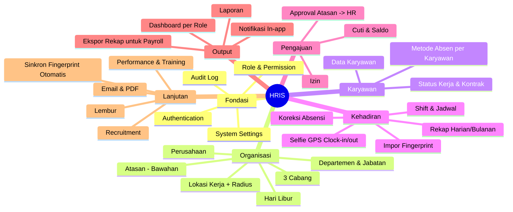
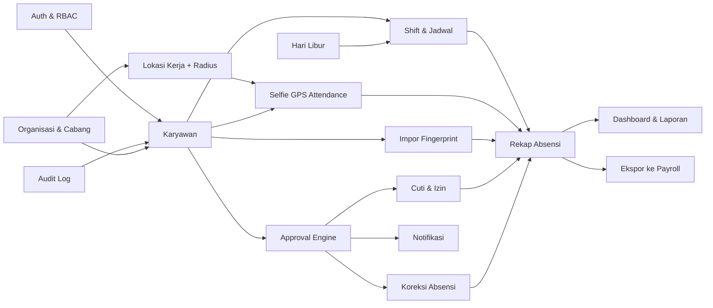
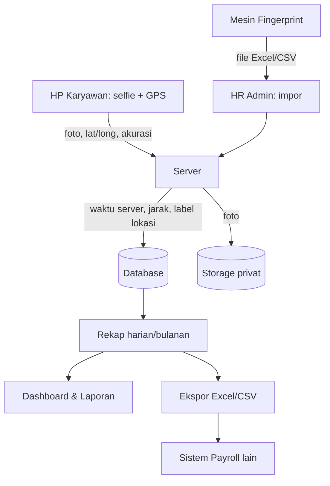
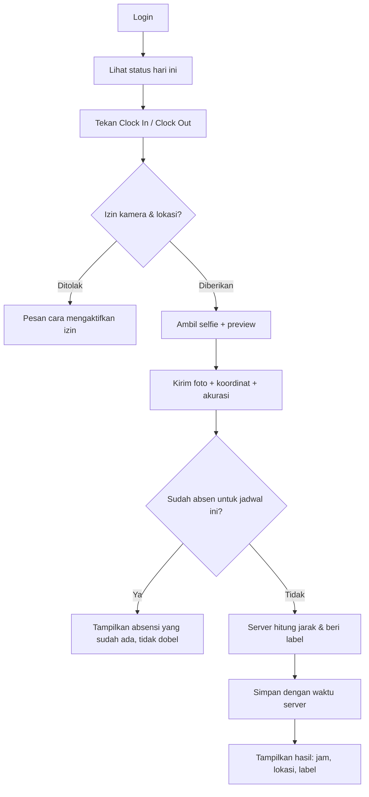
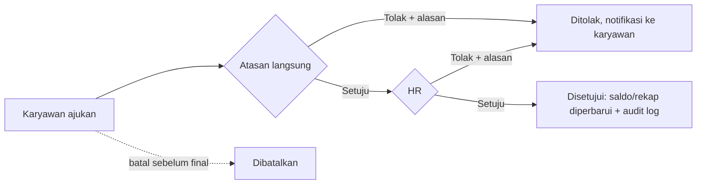
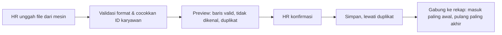

# Mind Map & Scope — HRIS (Phase 2)

Status: READY FOR REVIEW (2026-10-22). Berdasarkan `docs/REQUIREMENTS.md` revisi 1 (APPROVED).

## 1. System mind map

## 2. Module dependency map
Panah = "dibutuhkan oleh". Modul di kiri harus ada dulu.

Catatan dependensi:
- **Rekap Absensi** adalah titik temu: butuh jadwal, selfie GPS, fingerprint, cuti/izin, dan koreksi agar status "Tidak Hadir" tidak salah.
- **Approval Engine** dibuat sekali dan dipakai ulang oleh cuti, izin, dan koreksi (nanti juga lembur).
- **Audit Log** dibuat di fondasi supaya semua modul langsung tercatat sejak awal.

## 3. Alur data

## 4. User workflow map

### 4a. Absensi selfie GPS

Label lokasi: **Dalam radius**, **Luar radius**, **Akurasi rendah**, atau **Lapangan** (tanpa radius). Tidak ada yang ditolak.

### 4b. Approval cuti / izin / koreksi (2 tingkat)

### 4c. Impor fingerprint

## 5. MVP scope
| # | Modul | Isi MVP |
|---|-------|---------|
| 1 | Auth & RBAC | Login/logout, ubah & reset password oleh admin, 6 role, permission per modul, rate limiting. |
| 2 | Audit Log | Catat create/update/delete data penting + koreksi. |
| 3 | Organisasi | Perusahaan, 3 cabang, departemen, jabatan, atasan langsung, hari libur. |
| 4 | Lokasi Kerja | Koordinat + radius per lokasi (default 100 m). |
| 5 | Karyawan | Data inti, status aktif/nonaktif, metode absen (selfie GPS / fingerprint / keduanya), tipe lapangan. |
| 6 | Shift & Jadwal | Shift tetap + shift malam, penugasan karyawan, toleransi terlambat. |
| 7 | Selfie GPS | Clock-in/out, label lokasi, anti dobel, foto privat. |
| 8 | Impor Fingerprint | Unggah file, preview, anti duplikat. |
| 9 | Rekap & Koreksi | Rekap harian/bulanan, status hadir/terlambat/cuti/izin/tidak hadir, koreksi + approval. |
| 10 | Cuti & Izin | Jenis cuti, saldo + riwayat transaksi, pengajuan, approval 2 tingkat, pembatalan. |
| 11 | Dashboard & Ekspor | Dashboard HR/atasan/karyawan, laporan kehadiran, ekspor Excel/CSV untuk payroll. |
| 12 | Notifikasi In-app | Pengajuan baru, disetujui, ditolak. |

## 6. Future scope (setelah MVP stabil)
1. Lembur (pengajuan, approval, rekap, ikut diekspor).
2. Notifikasi email & reset password mandiri via email.
3. Laporan PDF.
4. Sinkron fingerprint otomatis (tergantung merek mesin, Q9).
5. Dokumen karyawan & kontrak + pengingat kontrak berakhir.
6. Riwayat jabatan/mutasi.
7. Recruitment & onboarding.
8. Performance & training.
9. PWA (ikon di layar HP).

**Di luar scope:** perhitungan payroll, BPJS, PPh 21, slip gaji.

## 7. Prioritas implementasi (usulan, difinalkan di Phase 6)
1. Fondasi: Auth, RBAC, Audit Log.
2. Organisasi, Lokasi, Karyawan.
3. **Selfie GPS Attendance** (fitur utama, dibuat sedini mungkin agar bisa diuji di HP).
4. Shift & Jadwal.
5. Rekap & Koreksi + Approval Engine.
6. Cuti & Izin.
7. Impor Fingerprint.
8. Dashboard, Laporan, Ekspor, Notifikasi.

## 8. Risiko & kompleksitas
| Area | Kompleksitas | Risiko utama |
|------|-------------|--------------|
| Selfie GPS | Tinggi | Kamera/GPS butuh HTTPS; perilaku browser berbeda di Android vs iPhone; GPS palsu tidak bisa dicegah penuh. |
| Shift malam & rekap | Tinggi | Salah hitung tanggal/durasi jika aturan tanggal shift tidak konsisten. |
| Impor fingerprint | Sedang | Format file berbeda per merek mesin (menunggu Q9); ID karyawan di mesin harus cocok. |
| Approval 2 tingkat | Sedang | Atasan tidak ada/kosong → perlu aturan pengganti (usulan: langsung ke HR). |
| Saldo cuti | Sedang | Harus konsisten saat pembatalan/penolakan; wajib transaksi tercatat. |
| Storage foto (free tier) | Sedang | Penuh dalam 1–2 bulan testing; perlu kompresi & kebijakan retensi. |
| Absensi luar radius diterima | Bisnis | Kecurangan hanya terdeteksi lewat pemeriksaan label oleh HR/atasan. |
